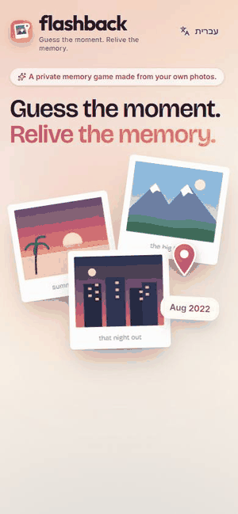

# flashback

**Guess the moment. Relive the memory.**

flashback turns your own photos into a private memory game. Players see a tightly zoomed-in piece of a photo, widen the view if they need to, then guess **where** (a pin on a real world map) and **when** (a month and a year, on two scroll wheels at the bottom of that same map). Then the full photo, the real place and date, and your story are revealed.

<p align="center">
  
</p>

<p align="center"><a href="docs/media/demo.webm">Watch the demo video</a> · the content shown is the built-in demo (illustrations, fictional answers)</p>

## Highlights

* **Four ways to play**: **Couple** (pass the phone), **Family & Friends** (one screen, one team answer), **Partners** (a parent and a child as one team, built calm and predictable with autistic kids in mind), **Party** (everyone on their own phone, synchronized by the server). Party has a harder *Scratch* style where you scratch the photo clear and score less the more you reveal.
* **Your photos**: upload from your device or import with the **Google Photos Picker**. The date is pre-filled from the photo, and the place too when the file has GPS data. You can always change them.
* **Answers stay secret**: players only receive physically cropped, metadata-free clue images. The original photo and the correct place and date reach them only at the reveal.
* **English and Hebrew** (right-to-left), switchable in the header.
* **Private by design**: no sign-up, photos stay on your own server, and games are deleted automatically after 7 days.

## Quick start

Needs Node.js 20.9 or newer.

```bash
git clone https://github.com/ohadshapira/flashback.git
cd flashback
npm install
npm run dev
```

Open <http://localhost:3000> and press **Try the demo**. No accounts or keys are needed.

## Documentation

| | |
|---|---|
| [Installation guide](docs/INSTALL.md) | Requirements, configuration, map, Google Photos setup, tests, troubleshooting |
| [Reference](docs/REFERENCE.md) | Game modes, scoring, security model, multiplayer, limits |
| [Run it on a small Google Cloud VM](docs/DEPLOY-GCP.md) | Docker, automatic HTTPS, personal-use server |

flashback needs one always-on server with a persistent disk, so it cannot run on GitHub Pages or other static hosts.
